# BlockTrade

Minecraft 风格的纯 C# 方块股市游戏，使用 **Godot 4.7.2 stable mono**。

游戏只有英文名 **BLOCKTRADE**，没有中文游戏名。

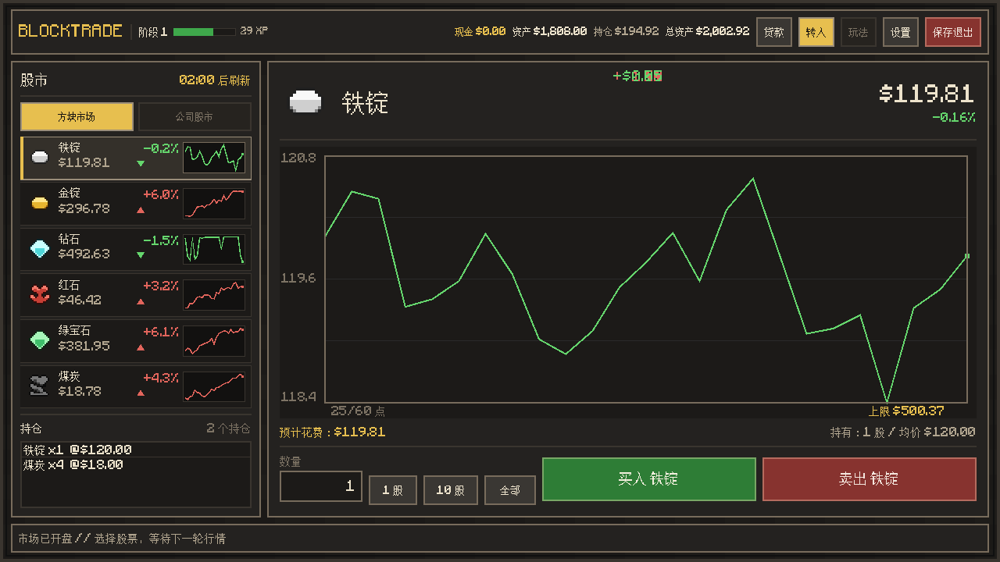

## 当前版本要点

- 初始状态：**现金 0 / 股市资产 2,000**
- 第一次进入股市必须设置 **6 位数字交易密码**
- 每次买入股票都要验证交易密码 + 随机文字图片验证码
- 现金与股市资产可以双向互转；顶栏右上角 `转入` 打开互转窗口
- 每次现金或资产变化都会在对应数值上方浮出 `+$100`（红色）或 `-$100`（绿色），随后淡出
- 每次行情刷新、交易、转入/转出、玩法和密码设置后都会自动保存
- 6 种商品全部使用中文名：铁锭、金锭、钻石、红石、绿宝石、煤炭
- 阶段 4 自动进入**公司股市**：8 家公司，单股 $1,600~$88,000
- 公司使用独立公司名和公司图标，不复用方块市场物品
- 阶段 2 新增青金石/石英，阶段 3 新增黑曜石/下界合金
- 新增银行贷款：最高 **50,000,000**，可借入/还款
- 资产不足时仍可买入，**资产允许变成负数**
- 刮刮乐改为**长按鼠标左键刮开**的银色涂层
- 大转盘改为固定指针 + 整轮旋转，不再随机切换高亮
- 所有商品和公司都可能在任何一次刷新中突然跌价
- 新增 Godot 导出预设：Windows / Linux / Android 的 Debug 和 Release
- 存档会保存**刷新间隔、剩余倒计时、现金/股市资产、交易密码和价格历史**
- 阶段（等级）系统：Lv.1 → Lv.4
- 高阶段解锁付费玩法：刮刮乐、老虎机、大转盘
- 升级时屏幕上方中央弹出解锁通知
- 新增合成音效、设置界面、快捷键
- 界面使用用户提供的 `Minecraft(同时支持中英文).ttf`
- 无 GDScript、无 GDExtension、无 C++

---

## 界面预览

| 主界面 | 剧情 |
|---|---|
| 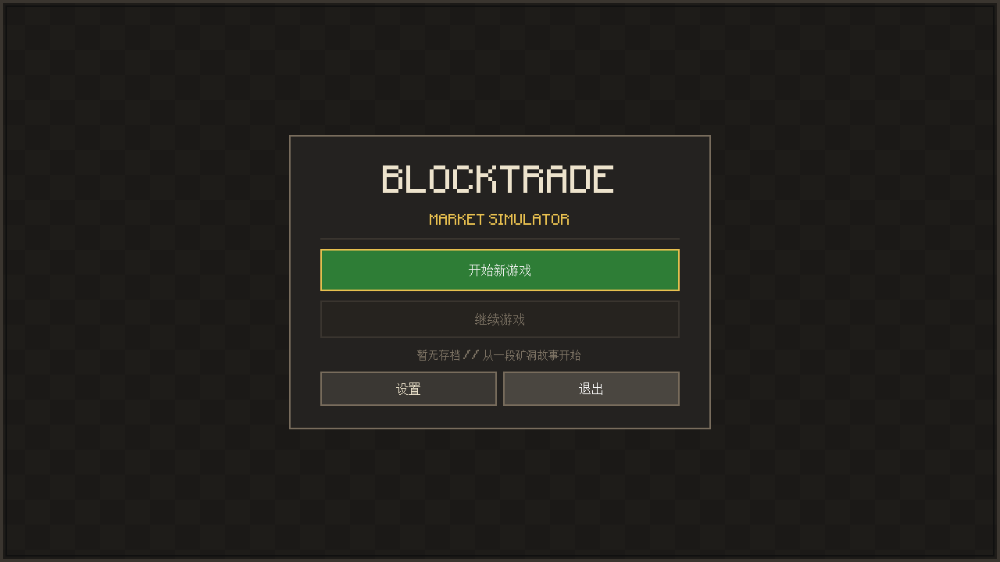 | 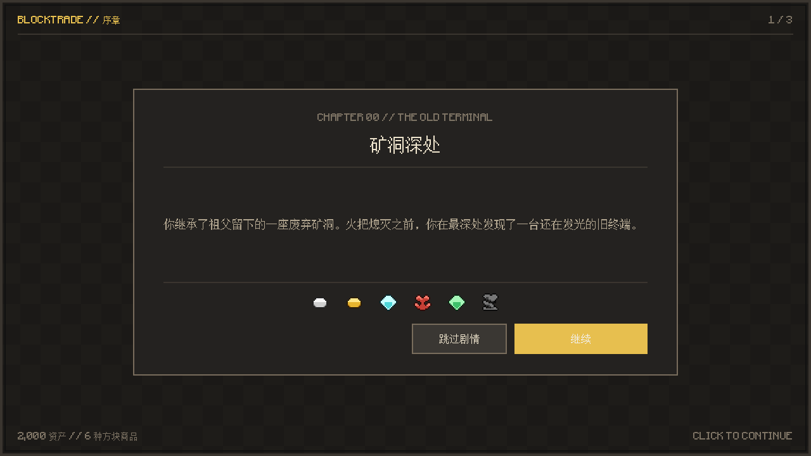 |

| 交易 | 阶段提升通知 |
|---|---|
|  | 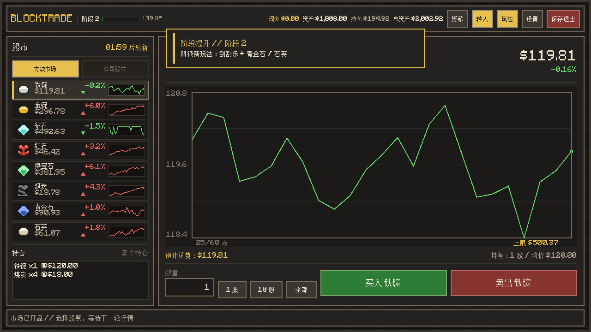 |

| 付费玩法 | 设置 |
|---|---|
| 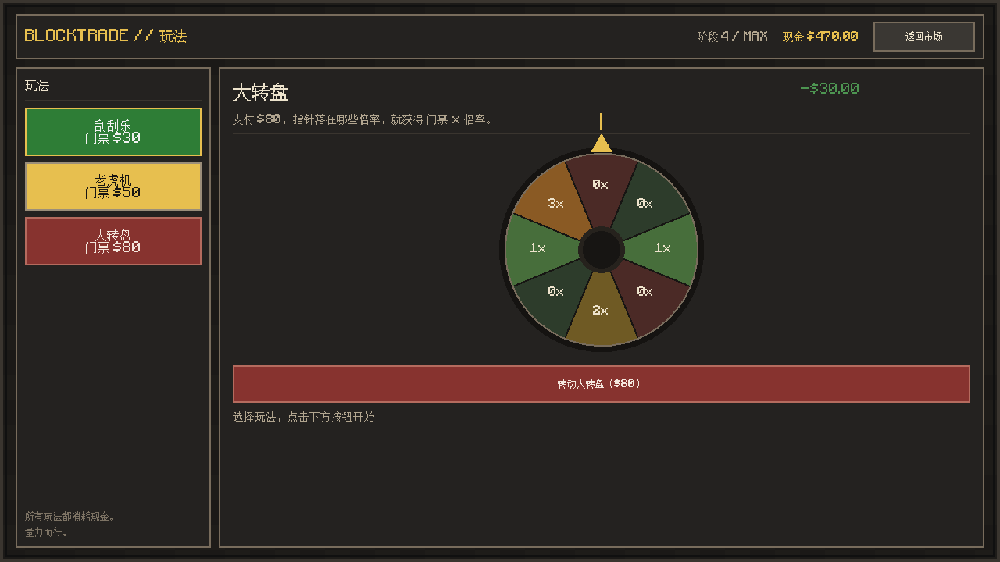 | 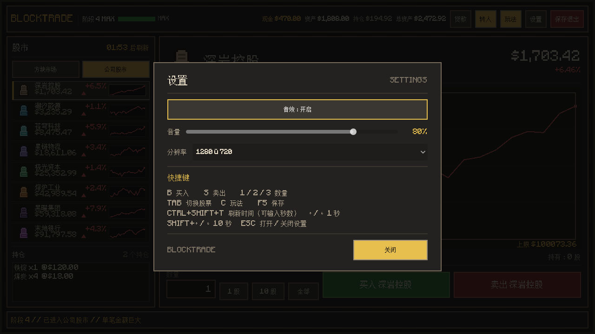 |

| 刮刮乐（长按左键） |
|---|
| 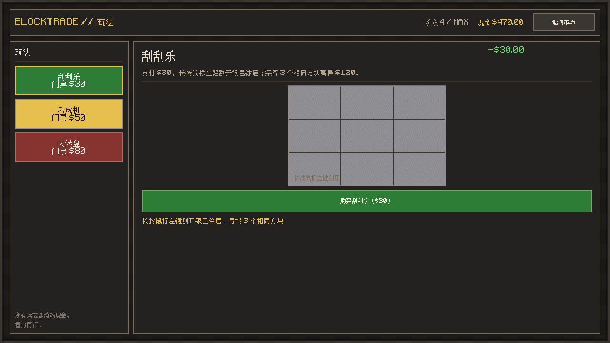 |

| 公司股市（阶段 4） |
|---|
| 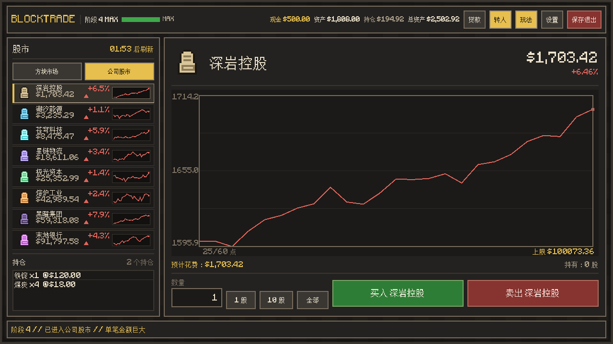 |

| 首次交易密码 |
|---|
| 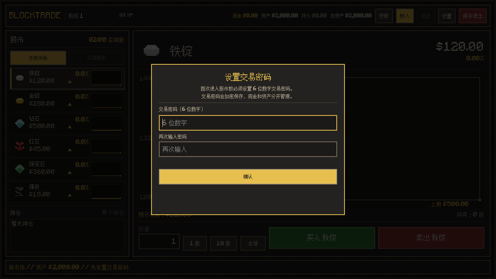 |

| 现金 / 资产互转 |
|---|
| 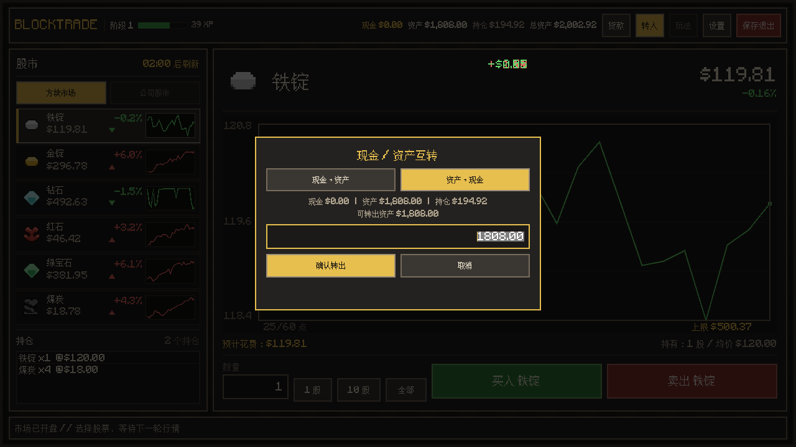 |

| 银行贷款 |
|---|
| 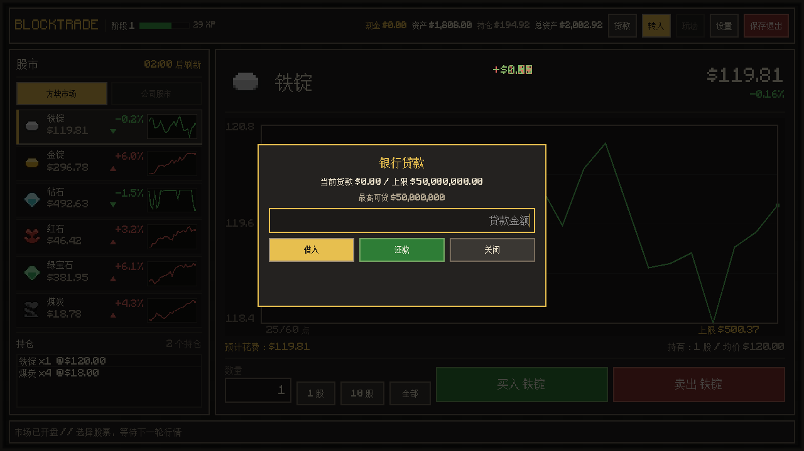 |

---

## 0. 环境与验证结果

| 项目 | 值 |
|---|---|
| 项目根目录 | 仓库根目录 |
| Godot 编辑器 | Godot 4.7.2 stable mono（路径以本机安装为准） |
| Godot 版本 | `4.7.2.stable.mono.official` |
| .NET SDK | `8.0.424`（也安装了 10.0.401） |
| 目标框架 | `net8.0` |
| 编译 | 0 警告，0 错误 |
| 核心测试 | 190 / 190 通过 |
| UI 端到端测试 | 120 / 120 通过 |
| 跨进程存档测试 | 13 / 13 通过 |

> 项目实际根目录是当前工作区；Godot 只是引擎路径，项目没有复制进引擎安装目录。

---

## 1. 游戏流程

```text
主界面
  ├── 开始新游戏
  │     └── 3 页矿洞剧情（打字机 / 可跳过）
  │           └── 交易界面
  ├── 继续游戏（读取存档，直接进入交易界面）
  ├── 设置
  └── 退出游戏
```

- 只有进入交易界面后才启动 2 分钟行情 Timer。
- 继续游戏时使用存档中的 `refresh_interval` 与 `refresh_remaining` 恢复倒计时。
- 存档损坏时回退到新游戏剧情，不崩溃。

---

## 2. 创建与运行

### 2.1 打开项目

1. 启动 Godot 4.7.2 stable mono。
2. Project Manager → **Import**。
3. 选择项目根目录的 `project.godot`。
4. 渲染器保持 **Compatibility**。
5. Import & Edit。

### 2.2 编译

```powershell
dotnet build BlockTrade.csproj -c Debug
# 或
dotnet build BlockTrade.sln -c Release
```

项目配置：[BlockTrade.csproj](BlockTrade.csproj)

```xml
<Project Sdk="Godot.NET.Sdk/4.7.2">
  <PropertyGroup>
    <TargetFramework>net8.0</TargetFramework>
    <EnableDynamicLoading>true</EnableDynamicLoading>
    <RootNamespace>BlockTrade</RootNamespace>
    <AssemblyName>BlockTrade</AssemblyName>
    <Nullable>enable</Nullable>
    <ImplicitUsings>enable</ImplicitUsings>
    <LangVersion>12.0</LangVersion>
  </PropertyGroup>
</Project>
```

Godot SDK 通过 NuGet 还原，需要能访问 nuget.org。

### 2.3 外部编辑器

- VS Code：安装 C# Dev Kit，打开项目根目录。
- Rider：打开 [BlockTrade.sln](BlockTrade.sln)，SDK 选择 .NET 8。

---

## 3. 项目结构

```text
BlockTrade/
├─ project.godot
├─ BlockTrade.csproj
├─ BlockTrade.sln
├─ export_presets.cfg
├─ README.md
├─ Assets/
│  ├─ Audio/               # 9 个合成音效 WAV
│  └─ Fonts/
│     ├─ Minecraft(同时支持中英文).ttf
│     └─ README.md
├─ Scenes/
│  └─ Main.tscn
├─ Scripts/
│  ├─ BlockTradeMain.cs
│  ├─ BlockTradeSimulator.cs
│  ├─ BlockTradeSaveData.cs
│  ├─ BlockTradeSaveManager.cs
│  ├─ BlockTradeSettingsStore.cs
│  └─ BlockTradeSoundManager.cs
├─ UI/
│  ├─ BlockTradeMainMenu.cs
│  ├─ BlockTradeStory.cs
│  ├─ BlockTradeUI.cs
│  ├─ BlockTradeDeltaPopup.cs
│  ├─ BlockTradeCasino.cs
│  ├─ BlockTradeScratchCard.cs
│  ├─ BlockTradeCaptcha.cs
│  ├─ BlockTradeRouletteWheel.cs
│  ├─ BlockTradeSettingsScreen.cs
│  ├─ BlockTradeNotifications.cs
│  ├─ BlockTradeStockList.cs
│  ├─ BlockTradeStockIcon.cs
│  ├─ BlockTradePixelArt.cs
│  ├─ BlockTradePriceChart.cs
│  ├─ BlockTradeTheme.cs
│  └─ BlockTradeBackdrop.cs
├─ Tests/
│  ├─ BlockTradeTests.cs / .tscn
│  ├─ BlockTradeE2ETests.cs / .tscn
│  └─ BlockTradeScreenshot.cs / .tscn
└─ Docs/
   ├─ .gdignore
   ├─ blocktrade-menu.png
   ├─ blocktrade-story.png
   ├─ blocktrade-auth.png
   ├─ blocktrade-transfer.png
   ├─ blocktrade-loan.png
   ├─ blocktrade-ui.png
   ├─ blocktrade-levelup.png
   ├─ blocktrade-company.png
   ├─ blocktrade-scratch.png
   ├─ blocktrade-casino.png
   └─ blocktrade-settings.png
```

---

## 4. 初始资金与商品

### 4.1 现金与股市资产

```csharp
public const double StartingCash = 0.0;
public const double StartingMarketCash = 2_000.0;
```

- 新游戏开始时：**现金 0，股市资产 2,000**
- `资产 = 可用股市资金`（买入后立即减少，卖出后增加）
- `持仓 = 持仓股票按当前价计算的市值`（随行情涨跌）
- `总资产 = 现金 + 资产 + 持仓`
- 买入股票只扣**股市资产**，不会使用外部现金
- 卖出股票只回到**股市资产**
- 顶栏右上角 `转入` 打开现金 / 资产互转窗口
- 可以选择 `现金 → 资产` 或 `资产 → 现金`
- 现金可以投入股市，资产也可以转成现金
- 互转窗口同时显示当前 `现金`、`资产` 和 `持仓`
- 每次互转都会在对应数值上方浮出 `+$100`（红色）或 `-$100`（绿色），随后淡出
- 行情涨跌导致持仓价值变化时，会在**持仓**数值上方浮出增减提示
- 股票列表有裁切和动态行高，不会覆盖持仓区
- 每次行情刷新、交易、互转、玩法和密码设置后自动保存
- 窗口较窄时优先显示“现金 / 资产 / 持仓”，总资产可隐藏

### 4.2 交易密码与验证码

第一次进入股市时弹出交易密码设置：

- 必须设置 **6 位数字**密码
- 密码使用 PBKDF2-SHA256 + 随机盐加密保存
- 每次**买入股票**都要重新输入交易密码
- 同时必须输入随机文字图片验证码
- 卖出、转出/转入现金不要求验证码

### 4.3 中文商品名

游戏逻辑和存档里的股票 key 已全部改为中文，不再使用 IRON/GOLD 等物品名。

| 商品 | 初始价 | 波动率 | 漂移 |
|---|---:|---:|---:|
| 铁锭 | 120 | 2.60 | +0.020 |
| 金锭 | 280 | 4.20 | -0.010 |
| 钻石 | 500 | 7.00 | +0.030 |
| 红石 | 45 | 1.40 | 0.000 |
| 绿宝石 | 360 | 5.50 | +0.010 |
| 煤炭 | 18 | 0.80 | -0.020 |
| 青金石 | 90 | 1.80 | +0.005 |
| 石英 | 60 | 1.20 | 0.000 |
| 黑曜石 | 300 | 4.80 | +0.015 |
| 下界合金 | 480 | 6.50 | +0.025 |

阶段解锁：

- 阶段 1：铁锭、金锭、钻石、红石、绿宝石、煤炭
- 阶段 2：新增青金石、石英
- 阶段 3：新增黑曜石、下界合金
- 阶段 4：公司股市 8 家公司

阶段 3 后左侧列表有 10 件商品，空间不足时可用**鼠标滚轮**滚动；列表行高会自适应，不会覆盖持仓。

旧 v1 存档中的英文名会在读取时自动迁移为中文：

```text
IRON → 铁锭
GOLD → 金锭
DIAMOND → 钻石
REDSTONE → 红石
EMERALD → 绿宝石
COAL → 煤炭
```

---

## 5. 阶段系统

实现：[BlockTradeSimulator.cs](Scripts/BlockTradeSimulator.cs)

### 5.1 阶段与 XP

- 阶段范围：1 ~ 4
- 到达下一阶段所需总 XP：80 / 220 / 450
- 成功交易获得 XP：

```csharp
25 + floor(成交金额 / 100)，最高 100
```

- 付费玩法也会给 XP（10 / 15 / 20）

| 阶段 | 解锁 |
|---|---|
| 阶段 1 | 基础交易：6 种商品 |
| 阶段 2 | 刮刮乐 + 青金石 / 石英 |
| 阶段 3 | 老虎机 + 黑曜石 / 下界合金 |
| 阶段 4 | 公司股市 8 家公司 + 大转盘 |

### 5.2 升级通知

阶段提升时，屏幕上方中央出现弹窗：

```text
阶段提升 // 阶段 2
解锁新玩法：刮刮乐
```

实现：[BlockTradeNotifications.cs](UI/BlockTradeNotifications.cs)

通知层位于所有界面之上，菜单、剧情、游戏、玩法和设置都能看到。

### 5.3 顶栏 XP

游戏顶栏显示：

```text
阶段 2    [绿色 XP 条]    139 XP
```

- `XpBar` 只显示当前阶段段内进度。
- 满级显示 `阶段 4 MAX`。

### 5.4 公司股市（阶段 4）

到达阶段 4 时：

- 左侧自动切换到**公司股市**；
- 顶栏或股市标签可切回**方块市场**；
- 公司股市显示 8 家公司；
- 公司名称、图标与方块商品完全独立；
- 单股价格 **$1,600 ~ $88,000**；
- 一笔 1 股买入/卖出就是数千到数万美元，金额巨大；
- 公司价格上限从 **$100,000** 起步，随后继续增长；
- 公司涨跌同样有回调，涨高后会下跌。

| 公司 | 初始股价 |
|---|---:|
| 深岩控股 | $1,600 |
| 潮汐能源 | $3,200 |
| 苍穹科技 | $8,000 |
| 星链物流 | $18,000 |
| 极光资本 | $25,000 |
| 熔炉工业 | $42,000 |
| 黑曜集团 | $55,000 |
| 末地银行 | $88,000 |

公司持仓计入顶栏的 **持仓** 数值；`资产` 只是可用股市资金，不包含持仓和现金。

实现：[BlockTradeSimulator.cs](Scripts/BlockTradeSimulator.cs)、[BlockTradeUI.cs](UI/BlockTradeUI.cs)、[BlockTradeStockList.cs](UI/BlockTradeStockList.cs)

---

## 6. 付费玩法

实现：[BlockTradeCasino.cs](UI/BlockTradeCasino.cs)

入口：游戏顶栏 **玩法**。阶段 1 禁用；阶段 2 解锁第一个玩法。

所有玩法都直接扣除现金；现金不足返回失败，不会透支。

| 玩法 | 解锁阶段 | 门票 | 规则 |
|---|---:|---:|---|
| 刮刮乐 | 2 | $30 | 长按鼠标左键刮开银色涂层，3 个相同方块奖励 $120 |
| 老虎机 | 3 | $50 | 三个相同奖励 $400，两个相同奖励 $50 |
| 大转盘 | 4 | $80 | 固定指针 + 整轮旋转，按指针所在倍率派奖 |

所有玩法消耗的都是**现金**，不是股市资产。

### 6.1 刮刮乐

- 点击 `购买刮刮乐` 扣 $30。
- 出现一张银色涂层刮刮卡。
- **长按鼠标左键并拖动**才能擦掉涂层。
- 涂层透明度按擦除像素逐渐消失，露出 3×3 方块商品。
- 当擦除面积达到阈值后结算。
- 出现 3 个相同方块奖励 $120。
- 中奖有音效和顶部状态提示。

实现：[BlockTradeScratchCard.cs](UI/BlockTradeScratchCard.cs)

### 6.2 老虎机

- 三个显示框，点击旋转扣 $50。
- 三栏滚动约 0.5 秒后停止。
- 三连奖励 $400，二连奖励 $50。
- 自带 spin / win / lose 音效。

### 6.3 大转盘

自定义 `BlockTradeRouletteWheel` 绘制 8 个扇形：

```text
0x / 0x / 1x / 0x / 2x / 0x / 1x / 3x
```

- 点击旋转扣 $80。
- 指针固定在顶部，整张转盘旋转约 0.8 秒后停在指针下。
- 不再随机切换高亮格子。
- 派奖 = 门票 × 指针所指倍率。
- 使用轮盘、win、lose 音效。

---

## 7. 两分钟行情与刷新时间存档

### 7.1 默认 2 分钟

```csharp
[Export(PropertyHint.Range, "5,600,5")]
public double RefreshIntervalSeconds { get; set; } = 120.0;
```

`Scenes/Main.tscn`：

```text
TickTimer.wait_time = 120.0
TickTimer.one_shot = true
TickTimer.autostart = false
```

游戏内按 `Ctrl+Shift+T` 打开刷新时间设置：

- 输入框可直接输入精确秒数，按 Enter 或“应用”
- `↑` / `↓` 每次 +1 / -1 秒
- `Shift+↑` / `Shift+↓` 每次 +10 / -10 秒
- 范围 5~600 秒
- 调整后立即重启 Timer 并保存
- 再按 `Ctrl+Shift+T` 或 `Esc` 关闭

### 7.2 保持上次存档的刷新时间

新增两个存档字段：

- `refresh_interval`：刷新间隔，默认 120 秒
- `refresh_remaining`：距离下一次刷新的剩余秒数

保存时：

- UI 在交易 / 保存时从 `Timer.TimeLeft` 同步到 `MarketRefreshRemaining`
- Main 每帧也同步一次
- 关闭窗口时同步后保存

读档时：

- 恢复 `RefreshIntervalSeconds`
- 用保存的 `refresh_remaining` 启动一次性 Timer
- 第一次刷新后恢复为完整 2 分钟周期

因此等待期间退出游戏，再次进入会从剩余时间继续，而不是重新 2 分钟。

### 7.3 价格模型：从 500 开始增长

默认初始价格上限为 **500**：

```csharp
public const double InitialPriceCeiling = 500.0;
```

每次刷新时，每件商品按价格百分比做一次随机增加/减少，并带有短期正向偏置。当前规则：

- 短期上涨偏置 **0.22%/次**
- 对最近 10 次价格均线存在均值回归
- 价格高于初始价越多，止盈回调压力越强
- 波动率提高，随机下跌更明显
- 因此涨得高的股票也会出现下跌段，长期单边上涨更难

随着游戏时间增加：

- 价格变化幅度会逐渐加大；
- 价格上限从 500 开始慢慢增长；
- 长局中商品可以突破 500，但仍有 1,000,000 的安全硬上限；
- 价格永远不会低于 1。

当前上限：

```csharp
public double GetPriceCeiling()
{
    double hours = Math.Max(0.0, GameTime) / 3600.0;
    return Math.Min(MaxPrice, InitialPriceCeiling * Math.Exp(0.22 * hours));
}
```

这样前期价格保持在 500 以内，后期市场整体价值会越来越高。

### 7.4 每个商品自己的价格线

右侧 `PriceChart` 只显示当前选中商品的一条价格线：

- 选中左栏其他商品时，切到该商品自己的 60 点历史；
- 新游戏第一次进入时没有伪造历史，只有当前价格，因此显示为一条水平线；
- 这条初始水平线固定在图表**最低端**，给后续增长留出上方空间；
- 只有真实刷新才追加新的价格点；
- **红色表示上涨，绿色表示下降**；
- 图表下方显示 `当前点数 / 60` 和当前价格上限；
- 价格线 2px，无渐变、无抗锯齿。
- 价格历史写入存档；继续游戏时恢复曲线，不再变回平线。

---

### 8. 交易

- 初始**股市资产 2,000**，现金 0
- 可输入数量，也可用 `1 股 / 10 股 / 全部`
- 买入：校验股票、数量、**股市资产**、交易密码、图片验证码
- 卖出：校验股票、数量、持仓
- 卖出所得进入股市资产，不直接进入现金
- 顶栏 `转入`：现金与股市资产双向转换
- 买入使用股市资产；现金先转入资产后即可买入
- 加权均价：
  `(OldAvg * OldShares + Price * Shares) / (OldShares + Shares)`
- 清仓自动移除持仓
- 所有非法交易返回 `false`，状态不变，不崩溃
- 交易成功自动保存

### 8.1 交易密码与验证码

- 第一次进入交易界面时弹出 `设置交易密码`
- 密码必须是 6 位数字
- 密码使用 PBKDF2-SHA256 + 16 字节随机盐保存
- 每次都要求输入密码
- 验证码是程序绘制的随机 4 位文字图片，带干扰线/噪点
- 密码或验证码错误会保留交易验证框，验证码自动刷新

### 8.2 所有股票都可能跌价

每次刷新都有 **12%** 的额外抛售冲击概率：

- 方块商品会跌
- 公司股票也会跌
- 高价股同样会回调
- 上涨偏置不会阻止下跌
- 另有最近 10 次均线回归与高价止盈压力

因此不存在“只涨不跌”的股票。

### 8.3 银行贷款

顶栏右上角 `贷款`：

- 最高贷款 **$50,000,000**
- 借入金额进入现金
- 可以从现金还款
- 贷款余额、现金、股市资产分别记录
- 贷款余额写入存档
- 资产不足时仍可买入股票，`资产` 可以变成负数
- 贷款界面显示当前贷款和剩余额度

### 8.4 负数资产

`买入` 不再因为资产不足直接拒绝：

- 可用资产不足时会继续扣款
- 扣款后 `资产` 为负数
- 负数资产显示为 `-$...` 并使用下降色
- 可以通过转入/贷款补充资产
- 负数资产不能直接转出现金

---

## 9. 快捷键

| 按键 | 功能 |
|---|---|
| `B` | 买入 |
| `S` | 卖出 |
| `1` / `2` / `3` | 数量 1 / 10 / 全部 |
| `Tab` | 切换下一只商品 |
| `C` | 打开玩法 |
| `F5` | 手动保存 |
| `Ctrl+Shift+T` | 打开 / 关闭刷新时间设置 |
| 刷新时间设置中 `↑` / `↓` | 每次增加 / 减少 1 秒 |
| 刷新时间设置中 `Shift+↑` / `Shift+↓` | 每次增加 / 减少 10 秒 |
| 刷新时间输入框 | 输入任意整数秒后按 Enter 或“应用” |
| `Esc` | 打开 / 关闭设置 |
| 玩法内 `Space` | 开始当前玩法 |
| 玩法 / 设置内 `Esc` | 关闭面板 |

刷新时间设置范围 5~600 秒，支持精确到秒；调整后立即重启行情 Timer，并写入存档。

设置界面内即可查看快捷键。

---

## 10. 设置

实现：[BlockTradeSettingsScreen.cs](UI/BlockTradeSettingsScreen.cs)

入口：

- 主界面 `设置`
- 游戏顶栏 `设置`
- 游戏中 `Esc`

功能：

- 音效开关
- 音量滑条 0~100
- 分辨率选择：1280×720 / 1600×900 / 1920×1080 / 2560×1440
- 选择后立即调整窗口并保存，下次启动自动恢复
- 快捷键说明
- 设置写入 `user://blocktrade_settings.json`
- 游戏内打开设置会暂停行情 Timer，关闭后恢复
- 设置界面打开时不停止游戏进程，只暂停倒计时

---

## 11. 音效

实现：[BlockTradeSoundManager.cs](Scripts/BlockTradeSoundManager.cs)

17 个自合成 8-bit 风格 WAV：

```text
click / buy / sell / error / levelup / win / lose / spin / scratch
transfer / loan / repay / auth / company / tick / save / negative
```

- 10 个 AudioStreamPlayer 组成播放池
- 通用按钮点击音效自动挂载
- 新增资金互转、贷款、还款、密码验证、公司股市、行情刷新、手动保存、负数资产音效
- 买入 / 卖出 / 失败 / 升级 / 中奖 / 轮盘旋转均有独立音效
- 受设置中的开关和音量控制

---

## 12. 界面与字体

### 12.1 设计

- 更接近 MC 的方块物品图标、暖灰石质面板、硬边框
- 主界面极简：只保留标题、开始/继续、设置/退出和存档提示
- 顶栏集中现金、资产（可用股市资金）、持仓、总资产、阶段 XP、玩法、设置、保存退出
- **资产** = 可用股市资金，买入后立即减少
- **持仓** = 持仓股票市值，随行情涨跌
- **总资产** = 现金 + 资产 + 持仓，是另一项独立显示
- 现金与股市资产双向互转：现金可以投入股市，资产可以转成现金
- 左侧股市列表 + 迷你走势；右侧显示当前选中商品的一条价格线 + 交易
- 股票列表启用裁切和动态行高，不会覆盖下方持仓信息
- 移除多余的手动保存按钮和冗长说明，保持简洁
- 所有商品名直接显示中文
- 没有中文游戏名，标题只使用 BLOCKTRADE

### 12.2 字体

所有界面使用：

```text
Assets/Fonts/Minecraft(同时支持中英文).ttf
```

实现：

```csharp
public const string FontPath =
    "res://Assets/Fonts/Minecraft(同时支持中英文).ttf";
```

字体导入参数：

```text
antialiasing=0
hinting=0
subpixel_positioning=0
```

字体由项目所有者提供；公开发布前请确认分发/嵌入授权。

---

## 13. 存档

### 13.1 文件

```text
user://blocktrade_save.json
```

Windows：

```text
%APPDATA%\Godot\app_userdata\BlockTrade\blocktrade_save.json
```

### 13.2 版本 5 结构

```json
{
  "version": 5,
  "player_cash": 0.0,
  "market_cash": 1702.0,
  "loan_debt": 0.0,
  "trading_password_hash": "base64...",
  "trading_password_salt": "base64...",
  "game_time": 120.0,
  "level": 2,
  "xp": 95,
  "refresh_interval": 120.0,
  "refresh_remaining": 43.5,
  "stocks": [
    {
      "name": "铁锭",
      "price": 120.0,
      "base_price": 120.0,
      "volatility": 2.6,
      "drift": 0.02,
      "history": [120.0, 121.4, 119.8]
    }
  ],
  "holdings": [
    {
      "name": "铁锭",
      "shares": 1,
      "avg_cost": 120.0
    }
  ]
}
```

`history` 保存每件商品最近最多 60 个真实价格点。新存档的 `stocks` 同时包含 10 个商品和 8 家公司；旧的 v3/v4 存档如果缺少新商品或新公司，读取时会自动补齐。

继续游戏后：

- 右侧价格线恢复为上次的历史形状，不再变成一条平线；
- 左栏每个迷你走势图也同步恢复；
- 现金与股市资产分别恢复；
- 交易密码验证资料恢复；
- 剩余刷新时间继续使用存档中的值。

### 13.3 校验与迁移

- `version == 5`
- 股票数 0~100
- 每只股票历史最多 60 点，点值有限且不低于 1
- 价格 / 波动率 / 漂移有限且合理
- 现金 / 股市资产有限（允许负数）
- 贷款余额 0~50,000,000
- 交易密码 hash/salt 必须成对且是有效 Base64
- 阶段 1~4
- XP >= 0
- 刷新间隔 5~600 秒（支持精确到秒）
- 剩余倒计时 0~间隔
- 持仓必须引用已有股票
- 任何失败都调用 `InitMarket()`，不崩溃
- v1/v2/v3 存档自动迁移：
  - 英文名→中文
  - 阶段默认 1
  - 缺少 history 时以当前价格作为第一个点
  - 旧版 `player_cash` 转为股市资产，现金从 0 开始
  - 旧存档没有交易密码，首次进入时要求设置
  - 刷新默认 120

### 13.4 保存时机

- 交易成功
- 每次行情刷新后
- 设置交易密码 / 现金与资产互转 / 借入或还款
- 刮刮乐 / 老虎机 / 大转盘结算
- 快捷键调整刷新时间后
- `F5`
- 保存退出
- 系统窗口关闭
- 不在 `_Process` 中写文件

---

## 14. 测试

```powershell
dotnet build BlockTrade.csproj -c Debug

# 将 godot 替换为本机 Godot mono 控制台可执行文件
# 核心 / 交易 / 阶段 / 付费 API / 存档 / v1 迁移
godot --headless --path . res://Tests/BlockTradeTests.tscn

# 主界面 / 剧情 / 交易 / 设置 / 三种玩法 / 继续 / 损坏存档
godot --headless --path . res://Tests/BlockTradeE2ETests.tscn

# 跨进程存档（含阶段、XP、剩余刷新时间）
godot --headless --path . res://Tests/BlockTradeTests.tscn -- --persist-write
godot --headless --path . res://Tests/BlockTradeTests.tscn -- --persist-read
```

预期：

```text
RESULT: 190 passed, 0 failed
ALL TESTS PASSED
RESULT: 120 passed, 0 failed
ALL UI TESTS PASSED
BLOCKTRADE_PERSIST_READ_RESULT passed=True (13 checks)
```

损坏存档测试会打印 `JSON_PARSE_FAILED`，属于预期回退日志。

---

### 14.1 手动验收

| # | 操作 | 预期 |
|---|---|---|
| 1 | 启动 | 主界面，现金 0 / 资产 2,000，继续游戏禁用 |
| 2 | 开始新游戏 | 剧情，起始 2,000 资产，2 分钟刷新 |
| 3 | 跳过剧情 | 交易界面先设置 6 位交易密码 |
| 4 | 买入煤炭 5 股，再卖 2 股 | 需要密码+验证码，资产/持仓/XP 正确，自动保存 |
| 5 | 完成足够交易 | 升到阶段 2，顶部弹出「解锁刮刮乐」 |
| 6 | 打开玩法 | 刮刮乐可玩，老虎机/大转盘显示阶段锁 |
| 7 | 刮刮乐 | 扣 30，长按左键刮开涂层，结算并保存 |
| 8 | 升到阶段 3/4 | 老虎机/大转盘依次解锁，阶段 4 自动进入公司股市 |
| 9 | 打开设置，调音量/关音效 | 设置保存，按键有对应反馈 |
| 10 | 等 30 秒后保存退出，重启继续 | 刷新倒计时从剩余时间继续 |
| 11 | 关闭窗口再启动 | 自动保存，继续游戏可用 |
| 12 | 损坏存档后继续 | 回退剧情/新游戏，现金 0、资产 2,000，不崩溃 |
| 13 | 顶栏点 `转入`，试 500 转出再 200 转入 | 现金/资产双向变化正确 |

---

## 15. Godot 导出预设

文件：[export_presets.cfg](export_presets.cfg)

已提供 6 个预设：

```text
Windows Debug / Windows Release
Linux Debug / Linux Release
Android Debug / Android Release
```

输出目录：

```text
build/windows/BlockTrade.exe
build/windows/data_BlockTrade_windows_x86_64/
build/windows/BlockTrade-Windows-x86_64.zip
```

`.NET` 导出需要把 `BlockTrade.exe` 和同目录的 `data_BlockTrade_windows_x86_64/` 一起分发；压缩包已包含两者。

命令示例：

```powershell
# Windows Release（已实际生成）
godot --headless --path . --export-release "Windows Release" build/windows/BlockTrade.exe
```

要求：

- 已安装 **Godot 4.7.2 stable mono** 的 Windows Release 导出模板
- Windows Release 已实际导出并通过启动冒烟测试
- Linux / Android 预设仍保留，但还需要对应平台模板、SDK / JDK、keystore
- C# Android 导出属于 Godot 实验性功能

`build/` 已加入 `.gitignore`。

---

## 16. 字体与 GitHub 规则

当前字体由用户提供，不需要从 GitHub 下载。

如果后续文档或脚本新增 GitHub 链接，统一：

1. 不使用 `raw.githubusercontent.com`；
2. 转换为标准 `https://github.com/...`；
3. 加上 `https://fastgit.cc/` 前缀，例如：

```text
https://fastgit.cc/https://github.com/owner/repository
```

字体与授权说明见 [Assets/Fonts/README.md](Assets/Fonts/README.md)。

---

## 17. 主要文件

| 文件 | 职责 |
|---|---|
| [Scenes/Main.tscn](Scenes/Main.tscn) | 所有界面、Timer、音频、通知的入口场景 |
| [Scripts/BlockTradeMain.cs](Scripts/BlockTradeMain.cs) | 流程、Timer、设置暂停、存档、升级通知 |
| [Scripts/BlockTradeSimulator.cs](Scripts/BlockTradeSimulator.cs) | 行情、交易、阶段 XP、付费现金、存档状态 |
| [Scripts/BlockTradeSaveManager.cs](Scripts/BlockTradeSaveManager.cs) | JSON v5 存档、校验、v1~v4 迁移 |
| [Scripts/BlockTradeSoundManager.cs](Scripts/BlockTradeSoundManager.cs) | 音效播放池与按钮点击音 |
| [UI/BlockTradeUI.cs](UI/BlockTradeUI.cs) | 交易界面、交易密码、验证码、资产互转、快捷键、倒计时 |
| [UI/BlockTradeDeltaPopup.cs](UI/BlockTradeDeltaPopup.cs) | 现金 / 资产增减浮字 |
| [UI/BlockTradeCasino.cs](UI/BlockTradeCasino.cs) | 三种付费玩法 |
| [UI/BlockTradeScratchCard.cs](UI/BlockTradeScratchCard.cs) | 长按刮开涂层的刮刮乐 |
| [UI/BlockTradeCaptcha.cs](UI/BlockTradeCaptcha.cs) | 随机文字图片验证码 |
| [export_presets.cfg](export_presets.cfg) | Windows / Linux / Android Debug+Release 导出 |
| [UI/BlockTradeRouletteWheel.cs](UI/BlockTradeRouletteWheel.cs) | 自绘大转盘 |
| [UI/BlockTradeNotifications.cs](UI/BlockTradeNotifications.cs) | 顶部阶段提升弹窗 |
| [UI/BlockTradeSettingsScreen.cs](UI/BlockTradeSettingsScreen.cs) | 设置界面、分辨率 |
| [Scripts/BlockTradeSettingsStore.cs](Scripts/BlockTradeSettingsStore.cs) | 音效、音量、分辨率持久化 |
| [UI/BlockTradeStockList.cs](UI/BlockTradeStockList.cs) | 中文股票行 + 迷你走势 |
| [Tests/BlockTradeTests.cs](Tests/BlockTradeTests.cs) | 核心测试 / 跨进程测试 |
| [Tests/BlockTradeE2ETests.cs](Tests/BlockTradeE2ETests.cs) | 完整 UI 流程测试 |

---

## 18. 已知边界

- 阶段上限为 4，后续可继续加阶段和玩法。
- 付费玩法为本地随机数，没有联网排行榜。
- 字体由用户提供，未附独立授权文件。
- 游戏没有中文名，界面只保留英文 **BLOCKTRADE**。
- 刷新倒计时会在设置界面暂停，关闭设置后继续。
